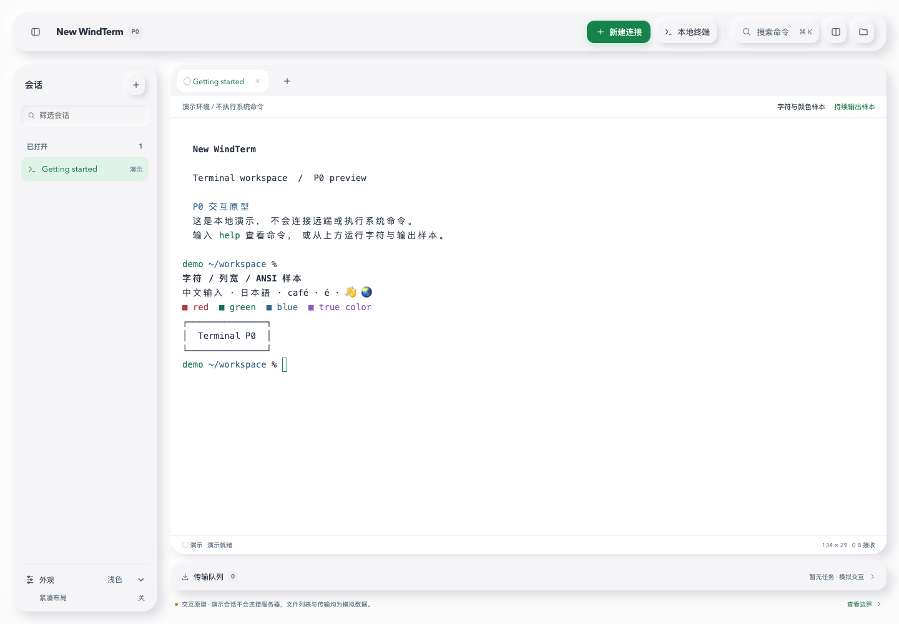

# new-windterm

面向 Apple Silicon 优先交付的终端与远程连接工具，使用 **Rust + Tauri 2 + xterm.js** 独立重构 WindTerm 的完整功能。

An independent Rust-based reimplementation targeting full WindTerm feature parity, starting with Apple Silicon Macs.

**当前状态：P0 进行中，已有本地交互、真实 PTY 与独立 SSH 固定命令验证入口；尚未完成 P0 验收，也没有正式发行版。** 项目名称暂定，与 WindTerm 上游没有隶属关系。

## 目标与范围

最终目标是对齐 **WindTerm 2.7.0 的实际完整功能**：终端与多协议连接、认证和转发、文件传输、tmux 集成、会话管理及 GUI 工作流。macOS M 系列优先，Windows/Linux 随后交付；平台顺序和阶段性 alpha 不代表删减功能，基础连接可用也不代表全量重构完成。

功能以[逐项对齐矩阵](docs/FEATURE_PARITY.zh-CN.md)管理。当前追踪130项：原117项保留，新增13项（11项入口已观察、2项静态候选），新增项行为均未实测；完整基线尚未冻结，功能对齐未完成。上游 README 与实际版本有差异的项目先实测确认；上游尚未实现的路线图不自动计入基线。

**浅色白银浮层与深色中性炭灰方向均已获用户认可。** 浅色保留白色画布、银白浮层、24px 主面板圆角与双向柔影；侧栏、标签/分屏、命令面板和模拟文件传输保持。深色截图已更新，方向认可不代表完整功能验收。[设计系统](docs/p0/DESIGN_SYSTEM.zh-CN.md) · [原型入口说明](docs/p0/UI_MAP.zh-CN.md)



[浅色连接表单](docs/assets/p0-light-connection.png) · [深色工作台](docs/assets/p0-dark-workspace.png) · [深色连接表单](docs/assets/p0-dark-connection.png)

## 本地开发与本轮结果

在 macOS 开发环境安装 Node.js/npm、Rust 工具链及 Xcode Command Line Tools，然后选择桌面模式或浏览器模式运行：

```sh
cd apps/desktop
npm ci
npm run tauri dev   # 桌面窗口，点击「本地终端」启动真实本机 shell
# 或使用 npm run dev，仅打开 http://127.0.0.1:1420 浏览器演示
```

`tauri dev` 会启动开发服务器，不要同时另开占用 1420 端口的 `npm run dev`。前端检查与构建使用 `npm run build`；Rust 与浏览器测试命令见[本轮结果](docs/p0/RESULTS.zh-CN.md)。

本机已生成的 debug 应用位于 `apps/desktop/src-tauri/target/debug/bundle/macos/New WindTerm P0.app`，属于本地构建产物，不随 Git 分发，也不是签名公证后的发行包。

本轮新增独立真实 SSH 验证入口：桌面程序从受控对端取得实际主机指纹，经本次信任后使用未加密 Ed25519 测试密钥执行固定命令 `fixture-check`。普通连接表单、交互 SSH shell、文件列表与 SFTP 传输仍是演示；不保存长期信任或凭据。入口、复核步骤与限制见 [SSH 客户端验证](docs/p0/SSH_CLIENT.zh-CN.md)。

浏览器本轮新增 SSH 界面契约回归；Rust 已通过独立复验，原生 SSH 成功路径完成实测，本轮三平台 CI 通过。各自范围及 Windows 构建警告统一记录在 [P0 结果](docs/p0/RESULTS.zh-CN.md)，不代表三端 GUI 或真实 SSH 全部通过。PTY 新增可公开复现的分支计量，默认读取与 ACK 策略未改，尚无性能达标结论。[性能诊断](docs/p0/PTY_PERFORMANCE_DIAGNOSIS.zh-CN.md)

此前已完成状态 DOM 合并、开发模式聚合诊断、隔离 VT52 实验、Linux Bash/Unix PTY 适配与三平台 CI 验证；Windows ConPTY 仍未实现。原生 IME、高输出响应、完整功能和发行验收仍待完成。

## 为什么做

WindTerm 2.7.0 发布页提供 macOS x86_64 包，未提供 arm64 包。Apple 已说明 macOS 27 是 Rosetta 的最后一个通用支持版本，macOS 28 起仅为特定旧游戏保留相关能力。因此，现有 x86_64 版本在 Apple Silicon 上面临后续兼容性风险；这不是 macOS 28 实测结论。WindTerm 仓库未归档，不能据此认定作者停止开发。[WindTerm 发布页](https://github.com/kingToolbox/WindTerm/releases/tag/2.7.0) · [Apple 支持](https://support.apple.com/en-us/102527) · [Apple 开发者说明](https://developer.apple.com/news/?id=w5ngl9k2)

## 已确认路线

Rust 负责协议、PTY、文件传输和状态管理，Tauri 2 提供桌面集成，xterm.js 承担终端渲染。当前原型依赖已锁定，后续协议依赖仍需 P0 核验。原生 arm64 指构建和运行架构，不等于全部采用 AppKit 原生控件；输入法、终端兼容性和输出性能仍需真机验证。[Tauri 架构](https://v2.tauri.app/concept/architecture/) · [xterm.js](https://xtermjs.org/)

- [实施路线与验收标准](docs/ROADMAP.zh-CN.md)
- [完整功能对齐矩阵](docs/FEATURE_PARITY.zh-CN.md)
- [架构设计](docs/ARCHITECTURE.zh-CN.md)
- [跨平台架构与分平台验收](docs/CROSS_PLATFORM.zh-CN.md)
- [界面与交互设计方向](docs/DESIGN.zh-CN.md)
- [现状核查与技术依据](docs/RESEARCH.zh-CN.md)
- [P0 本轮结果与未完成项](docs/p0/RESULTS.zh-CN.md)
- [本机 SSH/SFTP 受控夹具](docs/p0/SSH_SFTP_FIXTURE.zh-CN.md)：为独立 Rust SSH 验证提供受控对端，交互 SSH 与应用 SFTP 尚未实现。

完整工期需在功能盘点、原型验证和人力确定后估算，当前不承诺全项目交付日期。

## 许可证

本项目采用 [Apache-2.0](LICENSE)。Copyright 2026 new-windterm contributors.

当前未引入 WindTerm 的代码、图标或二进制。上游为部分开源项目，源码与第三方依赖具有各自许可证；未来复用需逐文件核查授权并保留归属。[许可证核查依据](docs/RESEARCH.zh-CN.md)
